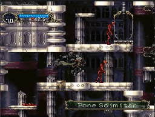
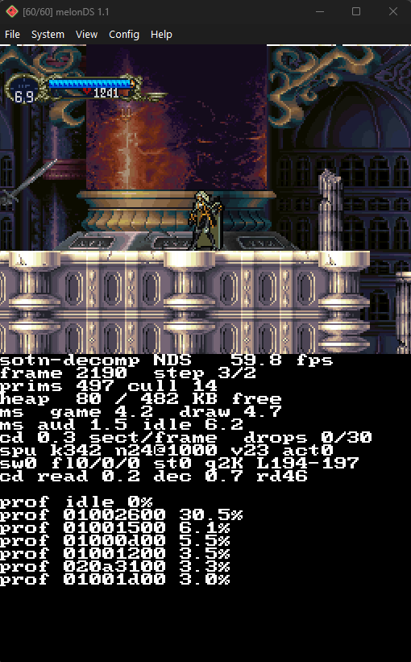
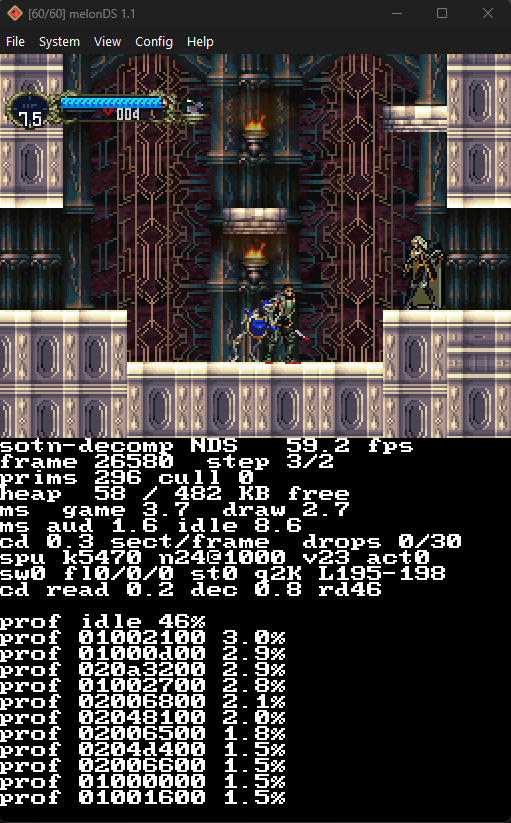
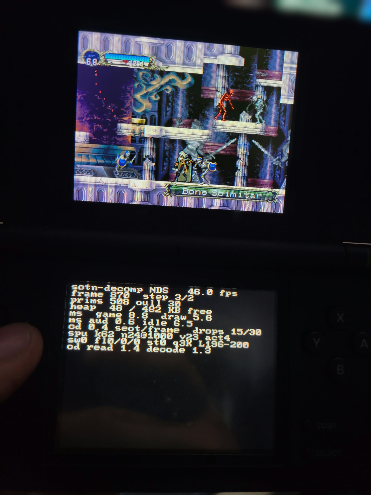
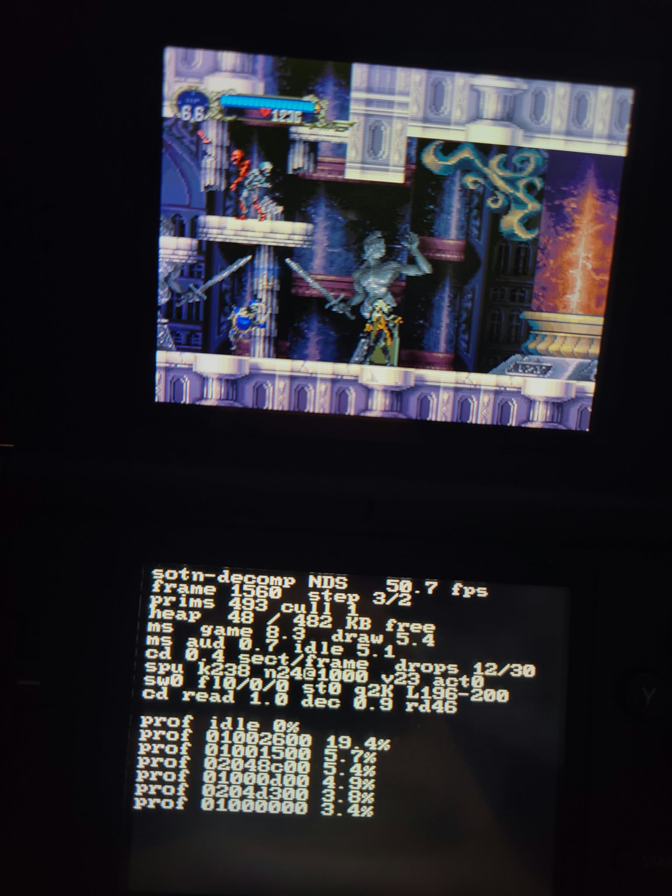

# Castlevania: Symphony of the Night — Nintendo DS port

An experimental port of **Castlevania: Symphony of the Night** (PlayStation, US
version SLUS-00067) to the **Nintendo DS**, built on top of the
[sotn-decomp](https://github.com/Xeeynamo/sotn-decomp) decompilation and its PC
port.

The game logic is the decompiled C code of the original game, compiled for the
DS's ARM9. What the port adds is a platform layer in `src/nds` that
stands in for the PlayStation hardware: the GPU, the SPU and the CD drive.

> **The source code isn't published yet.** For now this repository only
> holds this page. The code will land here once the port is complete; the
> build steps below describe how it will work.

> **No game data is included.** You need your own copy of the game to build a
> playable ROM. The ROM you build contains the game's data: don't share it.

## Screenshots

<p align="center">
  <a href="readme_media/gameplay.mp4">
    
  </a>
  <br>
  <sub>Alchemy Laboratory on melonDS. Click for the full one-minute video, with sound.</sub>
</p>

| melonDS | |
|:---:|:---:|
|  |  |

| Real hardware (DS Lite + flashcart) | |
|:---:|:---:|
|  |  |

The bottom screen shows the [debug overlay](#debug-overlay).

## Status

Work in progress. It runs on real hardware (tested on a DS Lite with a
flashcart) and on [melonDS](https://melonds.kuribo64.net/).

| | |
|---|---|
| Title screen, menus | ✅ |
| Alchemy Laboratory (NZ0) playable as Alucard or Richter | ✅ |
| Prologue (ST0) | ❌ the PC port sends it to NZ0 for now |
| HUD, stage names, enemies, bat form | ✅ |
| CD-XA music | ✅ |
| Sound effects and voices (software SPU) | ✅ |
| Speed | ~60 fps on melonDS; 50–57 on hardware, with frameskip to keep game speed |
| Other stages | ❌ not wired into the PC port yet |
| FMVs | ❌ |
| Saving | ❌ |

Known issues:

- On hardware some frames still tear at the top of the screen when many
  textures change in the same frame.
- Glitched frame on some room transitions.
- Leaving NZ0 towards a stage the port doesn't include stops the game.
- The PSX picture (256 or 512 pixels wide) is scaled to the DS's 256×192, so
  text is squashed vertically.

## Controls

| DS | PlayStation |
|---|---|
| D-pad | D-pad |
| B / A | Cross / Circle |
| Y / X | Square / Triangle |
| L / R | L1 / R1 |
| Start / Select | Start / Select |

On boot a short menu picks where to start:

- **A**: title screen
- **L**: Alchemy Laboratory (NZ0)
- **R**: play as Richter (asks for the prologue stage, ST0, which the PC port
  sends to NZ0 for now)

The bottom screen shows a performance overlay (see
[Debug overlay](#debug-overlay)).

## Building

You need Linux, or WSL on Windows (tested on Ubuntu 22.04).

### 1. Toolchain

Install [BlocksDS](https://blocksds.skylyrac.net/) through the Wonderful
toolchain:

```bash
# Wonderful toolchain bootstrap: see https://wonderful.asie.pl/docs/getting-started/
export PATH=/opt/wonderful/bin:$PATH
wf-pacman -Syu
wf-config repo enable blocksds
wf-pacman -Syu
wf-pacman -S blocksds-toolchain
```

You also need `cmake`, `ninja-build` and the decomp's own dependencies (Python,
Go and so on). See [the decomp's README](https://github.com/Xeeynamo/sotn-decomp#readme) and the
[upstream docs](https://github.com/Xeeynamo/sotn-decomp).

### 2. Game files

Put your disc image in `disks/` as `sotn.us.cue` plus its `.bin` tracks, then
extract it:

```bash
make extract_disk
```

This fills `disks/us/`. The port reads the game's files from there, the same
way the PC port does.

### 3. ROM

```bash
export WONDERFUL_TOOLCHAIN=/opt/wonderful
export BLOCKSDS=/opt/wonderful/thirdparty/blocksds/core
export PATH=/opt/wonderful/bin:/opt/wonderful/toolchain/gcc-arm-none-eabi/bin:$PATH

# Copy the files the game reads at runtime into the ROM's filesystem (NitroFS)
src/nds/make_nitrofs.sh build_nds/nitrofs

cmake -S . -B build_nds -G Ninja \
      -DCMAKE_TOOLCHAIN_FILE=$BLOCKSDS/cmake/BlocksDS.cmake
ninja -C build_nds
```

The result is `build_nds/sotn_nds.nds`, about **490 MB**, almost all of it CD
music. Copy it to the flashcart's SD card or open it in melonDS.

ninja doesn't track the contents of `build_nds/nitrofs`. If you change those
files, delete `build_nds/sotn_nds.nds` before building again.

## How it works

The decompiled game calls the PlayStation SDK (libgpu, libspu/libsnd, libcd).
The PC port in `src/pc` already replaces those libraries with portable C. The
DS port reuses it and adds a backend for each PSX chip:

| File | Replaces | How |
|---|---|---|
| `main_nds.c` | main loop, `DrawOTag` | Boot menu; walks each frame's ordering table and translates PSX primitives; frame pacing and frameskip; audio pump |
| `nds_gpu.c` | PSX GPU, 1 MB VRAM | Draws PSX primitives with the DS 3D engine (orthographic projection, depth increasing in draw order, PSX blend modes approximated with alpha) |
| `nds_spu.c` | PSX SPU, 512 KB sound RAM | Software SPU: decodes PSX ADPCM on the fly and mixes the 24 voices for the decompiled libsnd |
| `nds_audio.c` | audio output | A maxmod stream at 32768 Hz that mixes CD-XA music and SPU effects |
| `nds_hw.c` | the rest | Consoles, input, timers, sampling profiler, exception screen |
| `src/pc/psxsdk/libcd.c` | CD drive | Reads the CD-XA music from a raw copy of `XA_STR1` inside the ROM, skipping the interleaved channels of other tracks |

Some details of the DS side:

- **Virtual VRAM.** PSX VRAM (1 MB) doesn't fit in texture VRAM (banks A–D,
  512 KB):
  - It's split into 32 blocks of 128×128 halfwords. 16 of them live in VRAM
    and the rest in RAM, swapped in when a primitive samples them.
  - Blocks are stored as they are and sampled as 4, 8 or 16 bpp textures, so
    uploads need no conversion.
  - The CLUT rows are mirrored in the texture palette bank.
- **VBlank-only VRAM writes.** The 3D engine reads textures while it draws.
  Texture uploads are queued and applied by the VBlank interrupt (by DMA)
  before it starts rendering the next frame's top lines.
- **Overlapped frames.** The game logic of one frame runs while the previous
  one waits for its VBlank. Only drawing waits. A frame that falls behind skips
  drawing so the game keeps its speed.
- **Hot code in ITCM.** The drawing path, the ADPCM mixer and the XA decoder
  run from the ARM9's instruction TCM.
- **Memory.** Everything has to fit in the DS's 4 MB of main RAM next to the
  game's own buffers.

## Debug overlay

The bottom screen, refreshed every 30 frames:

| Line | Meaning |
|---|---|
| `fps` | game ticks per second (game speed) |
| `prims` / `cull` | primitives drawn / dropped as off screen |
| `heap` | free / total heap |
| `ms game, draw, aud, idle` | average milliseconds per frame in each part |
| `cd … s/f drop N skip N/30` | CD sectors per frame, frames over 16.7 ms, frames skipped |
| `spu …` | software SPU state |
| `sw fl st q L` | VRAM block swaps, early flushes, VRAM reads, KB copied in VBlank, scanlines the copy started and ended on (should end before 214) |
| `cd read / dec / rd` | CD read and XA decode time; the 3D engine's line-buffer margin (0 = overload) |
| `late N at ADDR` | VBlanks handled too late, and the code that held interrupts off |
| `prof ADDR N%` | sampling profiler: hottest code addresses |

Resolve addresses with:

```bash
arm-none-eabi-addr2line -f -e build_nds/sotn_nds.elf 0x02048c00
```

## Credits

- The [sotn-decomp](https://github.com/Xeeynamo/sotn-decomp) project and its
  contributors, for the decompilation and the PC port this is built on (see
  [the decomp's README](https://github.com/Xeeynamo/sotn-decomp#readme)).
- [BlocksDS](https://blocksds.skylyrac.net/), libnds and maxmod.
- [melonDS](https://melonds.kuribo64.net/), used for testing.

Castlevania: Symphony of the Night is © Konami. This project isn't affiliated
with or endorsed by Konami. The code is licensed under the
[AGPL-3.0](https://www.gnu.org/licenses/agpl-3.0.html), like the decompilation it is based on.
